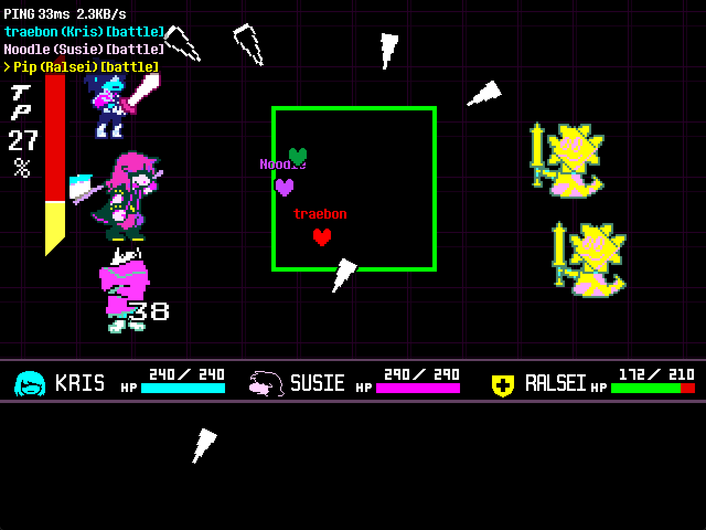
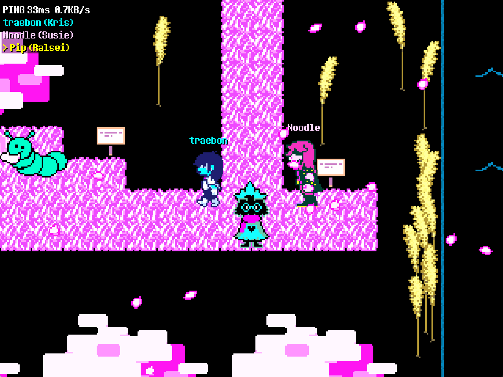
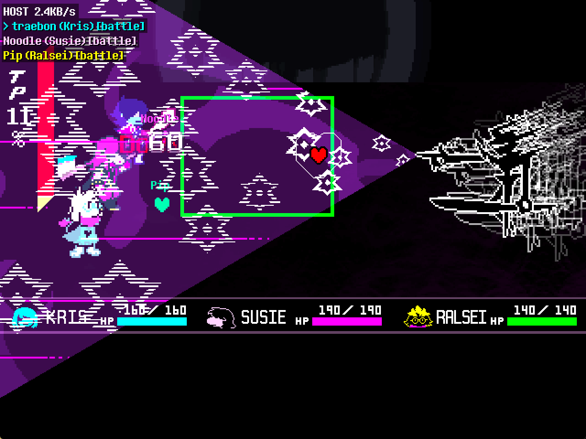
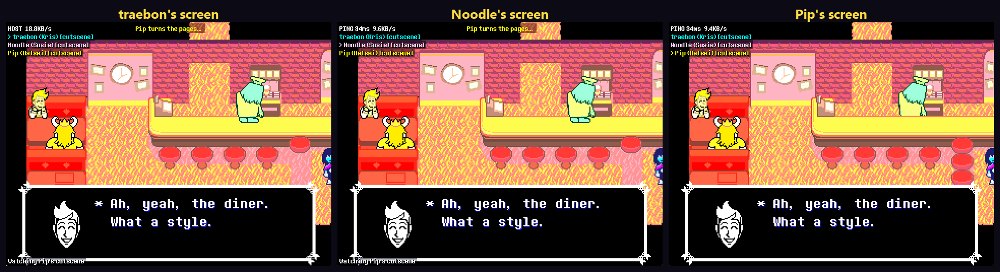

# DELTARUNE Online

By traebon. Based on [DELTARUNE Multiplayer](https://github.com/AeEn123AI/deltarune-multiplayer) by AeEn123AI (GPL-3.0).

> **Note: this project was written almost entirely by AI** (Claude, via Claude Code), directed and
> tested by a human. Expect rough edges and bugs, and please don't treat the code as hand-audited.
> It contains no DELTARUNE game files: the patcher modifies *your own* copy of the game.

## Download

**[Download DeltaruneOnline-Setup.exe](https://github.com/traeb0n/deltarune-online/releases/latest/download/DeltaruneOnline-Setup.exe)** (Windows 10/11, needs DELTARUNE on Steam).
Open it and click **INSTALL**. It updates itself from then on. See [Installing](#installing) and [Playing](#playing).
All versions are on the [Releases page](https://github.com/traeb0n/deltarune-online/releases).

## Screenshots









More in [docs/screenshots](docs/screenshots).

Online (network) co-op multiplayer for DELTARUNE Chapters 1–5, each player on their own PC, in the style of Block Tales' multiplayer:

* **Pick a party member.** Each player plays as Kris, Susie, Ralsei or (Chapter 2+) Noelle.
  Your character is what you walk around as, and in battle you choose that character's
  actions (FIGHT / ACT / MAGIC / ITEM / SPARE / DEFEND) and press for their attacks.
* **Everyone dodges.** In the bullet phase every player controls their own SOUL. A hit only
  hurts the character *you* play. If all of your characters are down, hits do nothing.
  Your grazes add to the shared TP bar.
* **Explore independently.** Walk and talk to NPCs on your own, even in different rooms.
  Other players appear as name-tagged characters when you're in the same room. A party
  member someone is playing never also follows you as an NPC, wherever that player is.
* **Battles and story cutscenes bring everyone together.** When someone touches an enemy
  or triggers a story cutscene, everyone else is pulled into that room. A story cutscene
  plays only in the game of whoever triggered it; everyone else sees exactly what that
  player's screen shows (characters, text boxes, sounds and music), and that player turns
  the text pages for everyone once they've finished typing on every screen.
* **Shared progress.** Story flags, items, gold, equipment and HP are kept in sync. The host's
  world is the shared one.
* **Built for bad connections.** It uses UDP with its own reliability layer: position updates
  are latest-only, and game events are acknowledged, retransmitted and delivered in order.
  Measured traffic is roughly 0.2–0.5 KB/s per player while walking and up to ~2 KB/s on
  the host during a 3-player battle. Tested at ~500 ms round-trip, 5% packet loss and
  64 kbit/s.

Up to 8 players can connect. Each party member is controlled by one player. Extra players,
or players whose character isn't in the party, watch (and dodge, harmlessly) in battle.
The host controls any party member nobody picked. Out of battle, a party member nobody plays (Ralsei, with two players) follows the host, and everyone sees that one.

## Online multiplayer, not local

This is **network multiplayer**: every player runs their **own copy of the game on their own
computer** and they connect over the internet (or a LAN) with UDP. It is not split-screen,
not shared-keyboard, and not Steam Remote Play. Each player has their own window, their own
keyboard or controller, and can walk to a different room from everyone else.

```
   Player 1 (host)                              Player 2 (client)
 +------------------+     UDP, port 26510     +------------------+
 | DELTARUNE + mod  | <---------------------> | DELTARUNE + mod  |
 | own screen/input |   positions, battle,    | own screen/input |
 +------------------+   story state, music    +------------------+
          ^                                              
          |  UDP     More players (up to 8) connect the same way
```

* One player hosts (forward **UDP 26510** on their router); the others join by typing the
  host's IP address in the F9 menu. There is no relay or central server.
* In the same room you see each other's characters walk around live, with name tags.
* The protocol is reliable-UDP with its own acknowledgements, so it copes with lag and
  packet loss (see "Network protocol" below).

## Battles, in two modes

The host picks one under F9 > Settings:

* **Open-world battles** (default). Touch an enemy and you fight it with the players on your screen in that room. Everyone else keeps playing, and any number of fights can run at once. A player in a fight stays visible where they stood, glowing and tagged [FIGHTING]; walk up to them and press Z (the prompt appears above them) to join at the next player turn. In a fight, only the heroes of its players take part, so a solo Susie or Ralsei fights alone, and may not be able to spare enemies. Story cutscenes and scripted bosses still bring in everyone. If your whole fight falls, only your fight sees Game Over: you come back at the room's entrance with some HP, and nothing is reloaded. If the player who started a fight leaves or loses connection, the next player in it takes over within about 10 seconds. A player already in a fight of their own isn't waited for when a story battle starts; their hero is played by the story fight's leader. A fight keeps the rules it started with if the host changes this setting meanwhile.
* **Everyone gets pulled in.** Every battle is every player's. A wipe sends everyone back to their last save.

**Timing.** Every game keeps a clock shared with the host. Before an encounter's "!" and before each turn, hero action and bullet phase, each game in the fight stops and reports ready. The fight's leader then names a moment slightly ahead and everyone starts at that moment, so someone with a higher ping doesn't start later. Nobody waits forever: there are time limits. Measured on one PC: at most about 18 ms apart (a frame is 33 ms).

Bullets are local: each game has its own, aimed at that player's SOUL, and only your own bullets touching your own SOUL hurt you. A bullet can seem to pass through another player's SOUL on your screen.

## Voice chat

Proximity voice: you hear players in the same room, quieter with distance. Push to talk by default (hold V), or open mic, or off. F9 > Settings has the microphone, talk key, mic volume, open mic sensitivity, voice volume, hearing range and a mic test. It uses about 8 KB/s per person talking. The microphone is only open while you talk.

## Installing

You need DELTARUNE on Windows (the Steam version with `chapter1_windows` ... folders). Every player needs the mod, at the same version.

Download `DeltaruneOnline-Setup.exe` from the [latest release](https://github.com/traeb0n/deltarune-online/releases/latest), open it and click **INSTALL** (if SmartScreen warns, choose More info, then Run anyway: the exe isn't signed). It finds your Steam copy, copies it to `%LOCALAPPDATA%\DeltaruneOnline\game` and patches the copy, so your Steam copy is never changed. Saves are kept in `%LOCALAPPDATA%\DELTARUNE_ONLINE`, apart from your normal ones. Start the game from the **DELTARUNE Online** shortcut: every time it opens it installs any new version, and it patches again by itself after a Steam update. Uninstall is at the bottom of its window. The launcher's source is in `launcher/`.

The older in-place `drm-patcher install` command still exists.

## Playing

1. Everyone starts DELTARUNE, picks the **same chapter** and loads (or starts) a game.
2. Press **F9** to open the multiplayer menu. Controls & info and Settings are in it.
   * **Name** and **Play as**: use left/right to pick your character. You can change it any
     time; it takes effect from the next battle turn.
   * The host chooses **Host a game**. The default port is UDP **26510**.
   * Everyone else sets **Host address** to the host's IP (e.g. `203.0.113.7:26510`) and
     chooses **Join game**.
3. Joining players are moved next to the host and receive the host's progress.

Handy things:
* **Shift+F8** (host, or "Bring everyone here" in the F9 menu) brings every player to where the host is. Anyone busy in a fight or cutscene is told to press F8 when they're done.
* **F8** (or "Go to ..." in the F9 menu) takes you to where the host is (the host goes to the
  first other player). Use it if you get stuck, a puzzle or room is out of step, or you simply
  want to catch up.
* **F7** (or "Stop all music and sounds" in the F9 menu) stops everything that is playing. Use it if the
  music gets out of step; the game starts a room's music again the next time you enter a room.
* Several players can pick the same character (with more players than party members someone
  has to). Everyone walks around as their pick; in battle the first player (lowest number)
  controls that character and the others watch. The F9 picker shows "(also P2: you watch
  battles)" when that is you.
* If your character isn't in a battle (or someone else controls it) you still see the attacks,
  but your SOUL is dimmed and marked **WATCHING**: you don't have to dodge, nothing hits you.
* When a chapter ends and you start the next one within a few minutes, the session continues
  by itself: the host hosts again and the others join again.
* After a Game Over and Continue, everyone is taken back to the host.
* If another player moves the story on while you are standing in a room, the room is
  rebuilt (same spot) a moment later so it matches theirs.
* Players are in the same world (Light / Dark) as whoever they join or are pulled to.
* An overworld enemy someone touched is gone for everyone afterwards (until you leave that
  room and come back, as in the normal game).

If the story gets stuck (a cutscene that never finishes, a character blocking the way for
good), the F9 menu has softlock tools:
* **F6 / "Noclip"**: walk through walls (only your own game; turn it off again with F6).
* **"Fix softlock: replay this room's story"** (host): puts the story back to how it was when
  you entered the room and enters it again for everyone, so its cutscene plays again.
* **"Fix softlock: story progress < N >"** (host): left/right (hold Shift for 10) change the
  game's story progress value, Z applies it for everyone and enters the room again. Example:
  Chapter 1, Susie blocks the way to Ralsei's training dummy after the Lancer battle in a save
  that got stuck: go back one room to the castle's front door (where Ralsei and Lancer
  appeared), set it to **19** and apply; that scene and the Lancer battle play again and the
  story carries on.

The player list (top-left) shows each player's character, ping and whether they're in a
battle or cutscene. The yellow line at the top tells you whose turn it is in battle
("Your turn: choose Susie's action!" / "P2 is choosing for Susie...").

**Playing over the internet:** the host must forward **UDP port 26510** on their router.
Alternatively, everyone can join the same virtual LAN (Tailscale, ZeroTier, Radmin VPN…) and
use the host's address on that network. A UDP tunnelling service (e.g. playit.gg) also
works.

Settings are saved in `multiplayer.ini` next to DELTARUNE's save files, and each session writes `multiplayer_log.txt` there (the one before is kept as `multiplayer_log_prev.txt`): send it along with a bug report. For testing, you
can also launch a chapter with `-mphost`, `-mpjoin <ip[:port]>`, `-mpname <name>`,
`-mpchar <1-4>` and `-mpport <port>`.

## How it works

Every player runs the full game; the mod keeps the copies in step instead of streaming
video or state.

| Situation | What is synchronised |
|---|---|
| Walking around | Your room, position and current sprite, ~10×/s and only when they change (unreliable, latest wins). Others draw you as a smoothly interpolated "ghost". |
| Story state | `plot`, flags (≥60), items, key items, equipment, gold, party, HP/stats. Changes are scanned every 2 frames and sent as small deltas. The full state goes out once on join. A player who loads a save re-fetches the host's state, and a host who loads pushes theirs to everyone. |
| Cutscene | If `global.interact` goes non-zero without the player pressing Z on something (or a door hands straight over to it), it may be a story cutscene. It counts once a new cutscene controller appears or the story progresses within 20 frames, or if it lasts over 4 s (so "you can't go that way" messages don't pull anyone). The others mirror it (`scr_mp_mirror`): they go to its room, whose instances are switched off so its own copy of the scene never runs, and draw the sprites the leader's game has on screen, sent every frame in drawing order with the camera (what each object draws is worked out by the patcher from its Draw event, `patcher/MirrorInfo.cs`). The leader's text boxes open as real text boxes in their games (same face, font and typing sound), the leader's sounds and music play, and choice boxes show the leader's answer. The leader turns the pages for everyone, once the page has finished typing on every screen (at most 15 s). At the end everyone is moved to where the leader ended up and their room is built again with the story changes. A player busy with their own cutscene joins afterwards if the other one is still going; pulls from earlier in the story than you are are ignored. Your character's look fades into the story's party when a cutscene starts. |
| Battle start | The initiator's encounter number is sent. Others start the same encounter (same music and "!" intro, same party) through an invisible `obj_testoverworldenemy`. Players busy in their own cutscene join after it ends. Late joiners enter at the start of the next turn. |
| Battle menu | The player who owns the character whose turn it is drives the menu. Their button presses, with the original frame spacing (at least 5 frames apart, so a press the menu would ignore as too early is never accepted in someone else's replay), are replayed in everyone's game, so every game's menu state machine (TP, items, ACT partners, going back with X) stays identical. |
| Attack timing | Each player presses only for their own character's bolts. Results are shared, and remote bolts wait for their owner's result. Damage is computed identically from the points. |
| Randomness | `random_set_seed` with the same seed at the start of the attack phase, enemy dialogue phase and bullet phase. |
| Bullet phase | Fully local: your SOUL, your hits (`scr_damage` re-targets to your character). The HP of each character is owned by its player and broadcast when it changes. |
| Turn barrier | Before each new turn, everyone reports "done" plus their TP gain from grazing. The host sends `TURN_GO` with the authoritative TP (base + everyone's grazes), HP, enemy HP, mercy and which enemies remain, plus who controls which character this turn. |
| Game over | A party wipe in any player's game is broadcast, so everyone in that battle goes down together. |

### Network protocol

One UDP socket. Each datagram (≤1200 bytes) carries a cumulative ack plus a 32-bit
selective-ack field and any number of records. Reliable records are retransmitted with an
RTT-based timeout and back-off, at most 4 datagrams per frame. Unreliable records (positions)
replace older queued ones and are dropped if they arrive out of order. The host is the hub and
forwards everything to the other players. Protocol version 9 (older versions can't join). Peers time out after 10 s of silence.

### Source layout

```
mod/gml/      new code: scr_mp_net (transport), scr_mp_core, scr_mp_world (ghosts,
              sprites, shared state), scr_mp_sync (cutscenes/pulls), scr_mp_battle,
              scr_mp_ui (F9 menu/HUD), scr_mp_test (automation), obj_mp_controller,
              obj_mp_ghost
mod/hooks/    small edits to the game's own code (see core.hook)
patcher/      drm-patcher: compiles the mod into a chapter's data.win (UndertaleModLib)
launcher/     DELTARUNE Online.exe: installer, updater and launcher (WinForms, .NET Framework 4.8)
installer/    update.txt (where the launcher looks for releases) and the package's READ ME FIRST.txt
tools/        test harness: game instances under Wine + Xvfb (*.sh, *.py) or on Windows (*.ps1)
```

The launcher builds with `dotnet build launcher/Launcher.csproj -c Release` and needs nothing
installed to run. `installer/update.txt` is built into it: a list of update sources, first choice
first (a GitHub repository whose latest release has `latest.txt` and `DeltaruneOnline-v<N>.zip`,
or a public Google Drive folder). It installs the highest version any source offers.

Building the patcher needs the .NET 10 SDK and an UndertaleModTool checkout
(`-p:UTMTRoot=...`, default `~/tools/UndertaleModTool`). The patcher's other commands are:

```
drm-patcher <in data.win> <out data.win> <mod dir> <chapter>   # patch one file
drm-patcher install|uninstall [DELTARUNE folder]
drm-patcher --decompile <data.win> <code entry>...             # inspect game code
drm-patcher --find-object <data.win> <object>                  # which rooms contain it
```

The patcher refuses to build if the mod references an object, sprite, sound, script or room
that the target chapter doesn't have.

## Testing that was done

All tests use real game instances under Wine on virtual displays. Each game writes a
self-check line twice a second (`-mptest check`): which character it draws for you, which
followers it draws, where it shows the other players, a hash of the shared story state, and
its sync state. `tools/mpcheck.py` compares these between players and fails if anyone is
drawn as the wrong character, a played character also appears as an NPC follower, another
player is shown somewhere they aren't, the shared state differs, anyone is left frozen, or
a game crashes.

* **Real game flow** (`tools/flow.py`): games are driven with real key presses through the
  file select (new game with name entry, or loading a save) and the F9 menu (pick a
  character, host, join), then a bot plays. Done in Chapter 4 (new game; 2 and 3 players;
  connecting at the file select or after starting; 250 ms / 5% loss), Chapter 2 (new game)
  and Chapter 1 (loading a save). The Chapter 4 opening shares the kitchen and church
  cutscenes between players.
* **Story cutscenes** (`tools/cutscenes.sh`): in Chapters 2–5 the host triggers a real
  cutscene (on entering a room, or by walking into it) while the others are in another room.
  They are pulled in and the cutscene plays in their games too (2 and 3 players).
* **Story and battle sweeps** (`tools/sweepgen.py`, `tools/sweep.py`): every room with story
  objects is visited at each story point it checks (about 560 scenarios in chapters 1-5), and
  every encounter is fought (3+ turns, battle state compared per turn), each with a host and
  a client joining from elsewhere. Crashes that also happen single-player are the game's own
  (rooms/encounters the game can't normally reach) and are listed in TODO.md. Late joiners
  (3 players) are pulled into a running battle.
* **Battles** (`tools/regress.sh`): 3 players in chapters 1–5, battle state identical every
  turn; earlier also ~500 ms RTT, 5% loss, 64 kbit/s.

## Known limitations

* Only cutscenes triggered by walking or entering a room are shared. Cutscenes started by
  pressing Z on something play only for the player who did it (their story changes still
  sync). Cutscenes that depend on a player's exact route may not trigger in the other
  games; those players watch frozen (seeing the leader's dialogue) until it ends and are
  then moved to the leader.
* Boss battles with heavily scripted mechanics haven't been played through in multiplayer.
  Turn-end snapshots fix up HP, TP, mercy and defeated enemies, but other enemy-specific
  state could still drift.
* Remote players' text boxes advance on their own, so players can be a few seconds apart.
  The turn barrier brings everyone back together each turn.
* Everyone must run the same chapter and the same mod version (checked on join).
* Not affiliated with Toby Fox or the DELTARUNE team. The patched game files are generated
  on your machine from your own copy of the game.

## License

GPL-3.0 (see `LICENSE`). The patcher links UndertaleModLib, which is GPL-3.0, so the whole project
is released under the same license. Third-party components are listed in `THIRD_PARTY.md`.
Mostly written with AI assistance (Claude Code).
